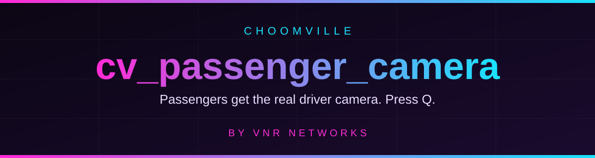

<p align="center">
  
</p>

<p align="center">
  
  
  
  
</p>

<p align="center"><b>A ChoomVille resource, built by VNR Networks</b></p>

---

## What it does

In vanilla multiplayer driving, only the **driver** can change the in-car camera. **cv_passenger_camera** gives **passengers** the exact same camera cycle, using the game's native vehicle perspectives (not a fake chase-cam approximation).

Each press of **Q** moves to the next view:

```
First person  ->  Close  ->  Medium  ->  Far  ->  (back to First person)
```

## Controls

| Button | Who | What happens |
|:------:|-----|--------------|
| **Q**  | Passenger in any vehicle | Cycle camera: First person -> Close -> Medium -> Far |
| **Q**  | Driver | Unchanged, works as normal |

That is the only button. There are no commands and no menus.

## How to use it in game

1. Get into a vehicle **as a passenger** (any seat that is not the driver seat).
2. Press **Q**.
3. Keep pressing **Q** to step through the four camera angles.
4. Nothing happens while a vehicle scene or combat lock is active (the game blocks camera changes then). Try again afterwards.

## Install

**Requirements:** an Open77 server (resource version `>=0.0.1`) and the `input.actions` permission available to resources.

1. Download this repo (green **Code** button -> **Download ZIP**) or `git clone` it.
2. Copy the `cv_passenger_camera` folder into your server resources folder, for example:
   ```
   server/resources/choomville/cv_passenger_camera/
   ```
3. Register it in your `server.jsonc` resources list:
   ```jsonc
   "choomville/cv_passenger_camera/cv_passenger_camera"
   ```
   Adjust the path to match where you placed the folder.
4. Restart the server (or start the resource). The client console should print:
   ```
   [cv_passenger_camera] native vehicle camera left open for passengers (Q = driver angles)
   ```

## How it works

| File | Job |
|------|-----|
| `open77.lua` | Resource manifest. Auto-starts, asks for `input.actions`. |
| `client/main.lua` | Makes sure the native vehicle-camera actions are never blocked, so Q can reach the game. |
| `client/redscript/CvPassengerCamera.reds` | Detects Q (`ToggleVehCamera`) while the local player is a passenger and sends the native `vehicleRequestCameraPerspectiveEvent` to cycle the view. |

## Status

Experimental. Server validation passes. The redscript layer relies on Open77 loading `client/redscript` files, which is not described in the public resource docs, so report whether it works on your build.

## Credits

Made with love by **[VNR Networks](https://github.com/VNR-Networks)** for the **ChoomVille** Cyberpunk 2077 server.

Released under the [MIT License](LICENSE).
